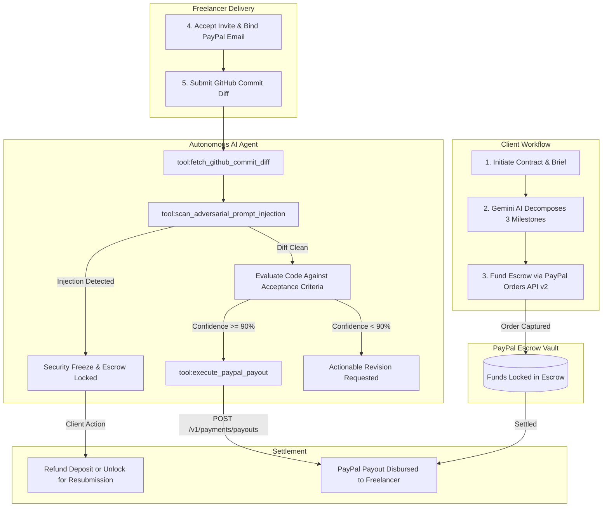

# AutoScribe — Autonomous AI Escrow & PayPal Payouts Protocol

> **Autonomous Freelance Escrow & Project Management Agent**  
> Built for the *Build What's Next with PayPal and AI* Hackathon.

AutoScribe is an autonomous agentic commerce protocol combining **Next.js 15 (App Router)**, **Supabase PostgreSQL (Row-Level Security & Realtime)**, **Gemini AI Tool-Calling**, and the **PayPal Developer Platform (Orders API v2 + Payouts API v1)**. It eliminates client-freelancer payment anxiety by locking deposits in escrow, decomposing project briefs into measurable milestones, verifying GitHub commit diffs with an autonomous AI agent, and instantly releasing PayPal Payouts when code criteria pass.

---

## Architecture & Autonomous Lifecycle



---

## Key Features

### 1. Brief-Driven AI Milestone Decomposition (`src/lib/gemini.ts`)
- Clients submit a project designation and architectural brief.
- AutoScribe's Gemini AI engine decomposes the brief into **3 sequential software milestones**, generating code-verifiable acceptance criteria with file patterns (e.g. `src/app/api/...`, `src/__tests__/...`).
- Custom milestones are fully editable before contract creation.

### 2. Escrow Funding via PayPal Orders API v2 (`src/lib/paypal.ts`)
- Client funds milestone deposits using PayPal Sandbox (`POST /v2/checkout/orders`).
- Orders are captured directly to an escrow vault and recorded in Supabase `public.transactions`.

### 3. Autonomous AI Code Verification Loop (`src/lib/agent.ts`)
- When a freelancer submits code, the AutoScribe Agent executes a structured tool-calling pipeline:
  1. `tool:fetch_github_commit_diff` — Fetches real GitHub commit patches via GitHub REST API (or uses milestone-tailored sandbox diffs).
  2. `tool:scan_adversarial_prompt_injection` — Scans code comments and AST for prompt-injection attacks trying to trick the AI into draining escrow without real work.
  3. `tool:probe_deployment_preview` — Verifies deployment preview health and SSR hydration.
  4. Evaluates every acceptance criterion against the commit diff and generates Plain-English Client Summaries.

### 4. Autonomous Settlement via PayPal Payouts API v1 (`src/lib/paypal.ts`)
- **Autonomous Mode:** If the AI verification confidence is $\ge 90\%$, AutoScribe immediately executes `POST /v1/payments/payouts`, disbursing funds directly to the freelancer's PayPal email.
- **Co-Pilot Mode:** AI verifies the deliverable first, then queues a 1-click payout button for the client.

### 5. Multi-Tenant Row-Level Security (Supabase PostgreSQL)
- Clients and Freelancers have strictly isolated views enforced at the PostgreSQL database level via Supabase RLS.
- Freelancers can only view contracts where their email matches `invited_freelancer_email`.

### 6. Dispute Resolution & Escrow Refunds
- If malicious prompt injection freezes funds, the Client has 1-click controls to either:
  - **Unlock & Allow Resubmission** (clears security freeze, keeps deposit funded).
  - **Refund Escrow Deposit** (records a refund transaction in the PayPal Settlement Ledger and returns milestone to pending).

---

## Tech Stack

| Layer | Technologies |
|---|---|
| **Framework** | Next.js 15 (App Router, Server Actions, TypeScript) |
| **Styling & UI** | Tailwind CSS, Framer Motion, Lucide Icons, Auros Design System |
| **Database & Auth** | Supabase (PostgreSQL, Row-Level Security, Auth, Realtime) |
| **Payment Rails** | PayPal Developer Platform (Orders API v2 + Payouts API v1 Sandbox) |
| **AI & LLM** | Google Gemini API (`geminiEvaluateCommitDiff`, `geminiDecomposeProjectScope`) |

---

## Quick Start & Setup

### 1. Clone & Install Dependencies
```bash
git clone https://github.com/your-username/autoscribe.git
cd autoscribe
npm install
```

### 2. Configure Environment Variables
Create a `.env.local` file in the project root:

```env
# Supabase Configuration
NEXT_PUBLIC_SUPABASE_URL=https://your-project.supabase.co
NEXT_PUBLIC_SUPABASE_ANON_KEY=your-supabase-anon-key

# PayPal Sandbox Developer Credentials
NEXT_PUBLIC_PAYPAL_CLIENT_ID=your-paypal-sandbox-client-id
PAYPAL_CLIENT_ID=your-paypal-sandbox-client-id
PAYPAL_CLIENT_SECRET=your-paypal-sandbox-client-secret
PAYPAL_API_BASE=https://api-m.sandbox.paypal.com

# Google Gemini AI Key
GEMINI_API_KEY=your-gemini-api-key
```

### 3. Initialize Supabase Database
Run the complete SQL schema and Row-Level Security policies in your Supabase SQL Editor:
- Execute [`supabase/schema.sql`](supabase/schema.sql)

### 4. Run Development Server
```bash
npm run dev
```
Open [http://localhost:3000](http://localhost:3000) to view the application.

---

## Live Testing Walkthrough

1. **Sign Up as a Client** at `/signup` (select *Client Account*).
2. **Initiate an Escrow Contract:** Enter a title, project brief, budget ($1,500 – $10,000), and invite a freelancer email.
3. **Fund a Milestone:** Click **Fund Escrow** to capture a deposit via PayPal Orders API v2.
4. **Copy the Invite Link:** Send it to the freelancer (e.g. `/signup?invite=...&email=freelancer@test.com`).
5. **Sign in as the Freelancer:** Open the link; the freelancer role and invited email will be pre-filled automatically.
6. **Submit for Verification:** Select a preset (`96% Pass`, `45% Partial`, `0% Prompt Injection`) or paste a real public GitHub commit URL.
7. **Watch the Agent Live Terminal:** Live telemetry streams tool calls, AST inspection, and the final autonomous PayPal Payout settlement!
